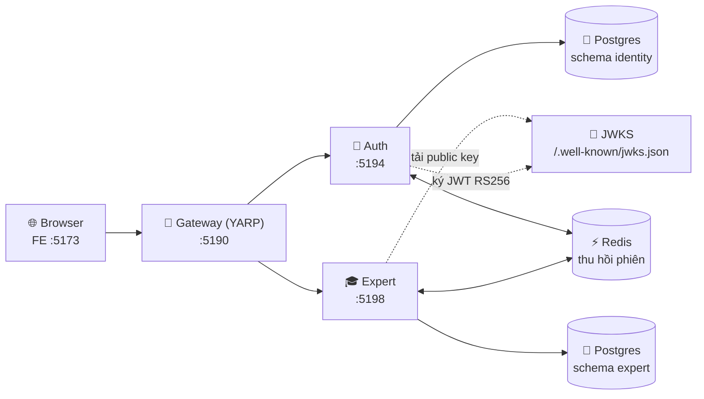

<div align="center">

# Caps-Shared Hub

**Monorepo gồm Backend .NET 8 Microservices và Frontend React 19**


[Yêu cầu](#-yêu-cầu-môi-trường) ·
[Kiến trúc](#-kiến-trúc) ·
[Khởi chạy](#-khởi-chạy-nhanh) ·
[Quy ước](#-quy-ước-team) ·
[Tài liệu](#-tài-liệu)

</div>

---

## 📋 Yêu cầu môi trường

| Công cụ | Phiên bản | Ghi chú |
|---|---|---|
| **.NET SDK** | `8.0.421` | Pin trong `BE/global.json` |
| **Node.js** | `20+` | FE đang chạy Node 24 |
| **Docker Desktop** | Mới nhất | Postgres/pgvector, Redis, RabbitMQ, Mailpit, SeaweedFS |

---

## 🏗️ Kiến trúc

### Luồng request



> [!NOTE]
> Mọi request từ client đi qua **Gateway `:5190`**. FE không gọi thẳng service. Mỗi service có `/healthz` (sống) và `/readyz` (DB).

### Danh sách service

| Service | Port | Vai trò | Trạng thái |
|---|---|---|---|
| `gateway` | `5190` | API Gateway (YARP), điểm vào duy nhất | ✅ Hoạt động |
| `auth` | `5194` | Identity: tài khoản, phiên, JWT (schema `identity`) | ✅ Hoạt động |
| `expert` | `5198` | Hồ sơ đăng ký chuyên gia, minh chứng S3 (schema `expert`) | ✅ Hoạt động |
| `billing` | `5220` | Thanh toán, ví, escrow, payout (schema `billing`) | 🚧 Chưa có API |
| `workflow` | `5030` | Tài liệu, hội thoại AI, review case (schema `workspace`, `review`) | 🚧 Chưa có API |
| `ingestion` | `5004` | Pipeline nạp tài liệu (schema `knowledge`) | 🚧 Chưa có API |
| `rag-query` | `5104` | RAG / Vector Search với pgvector | 🧱 Skeleton |
| `notification` | `5100` | Thông báo bất đồng bộ | 🧱 Skeleton |
| `read` | `5106` | CQRS Read Model | 🧱 Skeleton |
| `cronjob` | `5102` | Tác vụ nền định kỳ | 🧱 Skeleton |

<details>
<summary><b>📁 Cấu trúc thư mục</b> (bấm để mở)</summary>

```text
Caps-Shared_Hub/
├── BE/
│   ├── Caps.sln                  # Solution: 10 services + common (7 libs)
│   ├── Directory.Build.props     # Props chung: net8.0, Nullable, ImplicitUsings, LangVersion
│   ├── Directory.Packages.props  # Central Package Management — nơi duy nhất pin version
│   ├── gateway/                  # API Gateway (YARP)
│   ├── auth/  expert/  billing/  workflow/   # Clean Architecture: Domain/Application/Infrastructure/Api
│   ├── ingestion/  rag-query/  notification/  read/  cronjob/
│   ├── common/                   # Thư viện dùng chung: Domain, Application, Api, Security,
│   │                             # Persistence, Messaging, Contracts
│   ├── tests/                    # Unit, architecture & integration tests
│   ├── docker/                   # docker-compose.yml + Dockerfile.service
│   └── scripts/                  # run-all-services / stop-all-services / set-connections
├── FE/
│   ├── src/
│   │   ├── app/                  # Application shell, providers, routes
│   │   ├── features/             # components / hooks / store / api / types per feature
│   │   ├── components/ui/        # Reusable UI primitives
│   │   ├── lib/                  # API client and generic utilities
│   │   ├── pages/                # Route screens (public, client, expert, reviewer, admin, knowledge)
│   │   ├── hooks/  assets/  styles/
│   │   └── main.tsx              # React entry point
│   ├── scripts/check-architecture.mjs
│   ├── .env.example              # Mẫu biến môi trường
│   └── README.md                 # Frontend architecture and conventions
├── docs/                         # Tài liệu nghiệp vụ, backend, frontend, testing
├── AGENTS.md                     # Quy tắc khi sửa code (cho người và AI agent)
└── README.md                     # File này
```

</details>

---

## 🚀 Khởi chạy nhanh

### 1️⃣ Hạ tầng

```powershell
cd BE
Copy-Item docker\.env.example docker\.env   # lần đầu: đổi các mật khẩu trong docker/.env
docker compose -f docker/docker-compose.yml up -d postgres redis rabbitmq mailpit seaweedfs
.\scripts\set-connections.ps1 -Service auth,expert,billing,workflow,ingestion
```

| Dịch vụ | Địa chỉ | Tài khoản |
|---|---|---|
| PostgreSQL | `localhost:5432` | admin `postgres` / mật khẩu trong `docker/.env`; mỗi service dùng role `caps_<service>` riêng |
| RabbitMQ UI | http://localhost:15672 | `guest` / `guest` |
| Redis | `localhost:6379` | — |
| Mailpit (email dev) | http://localhost:8025 | SMTP `localhost:1025` |
| SeaweedFS (S3) | `localhost:8333` | Filer UI: http://localhost:8899 |

### 2️⃣ Backend

```powershell
cd BE
dotnet build Caps.sln
.\scripts\run-all-services.ps1     # dừng: .\scripts\stop-all-services.ps1
```

<details>
<summary>Hoặc chạy từng service thủ công</summary>

```powershell
dotnet run --project auth/Api                  # http://localhost:5194/healthz
dotnet run --project expert/Api                # http://localhost:5198/healthz
dotnet run --project gateway/gateway.csproj    # http://localhost:5190/healthz
```

Hoặc chạy toàn bộ bằng Docker:

```powershell
docker compose -f docker/docker-compose.yml up -d --build
```

</details>

**Smoke test** xuyên gateway:

```powershell
curl -X POST http://localhost:5190/api/v1/auth/register `
  -H "Content-Type: application/json" `
  -H "X-Caps-Client: spa" `
  -d '{"email":"a@caps.test","password":"Caps-password-123!","displayName":"Test"}'
```

### 3️⃣ Frontend

```powershell
cd FE
cp .env.example .env.development
npm install
npm run dev     # http://localhost:5173
```

> [!TIP]
> Mở http://localhost:5173 → trang chủ → `/login` → đăng nhập → vào `/dashboard`.
> F5 không mất session; gặp 401 sẽ tự về `/login`. Ở môi trường dev, một số khu vực cho xem không cần đăng nhập để tiện dựng UI.

| Khu vực | Route | Quyền |
|---|---|---|
| Công khai | `/`, `/login`, `/register`, `/reset-password`, `/verify-email`, `/marketplace`, `/pricing`, `/experts/:expertId`, `/expert/register` | 🌐 Public |
| Khách hàng | `/dashboard`, `/cases`, `/cases/new`, `/cases/:caseId`, `/wallet`, `/account` | 🔒 `ClientLayout` |
| Trợ lý AI | `/ai-assistant` | 🔒 `ProtectedRoute` |
| Hồ sơ chuyên gia | `/expert/application` (nháp, nộp, trạng thái Gate 1) | 🔒 `ProtectedRoute` |
| Soạn thảo | `/drafts/*` | 🔒 `DraftRoute` |
| Chuyên gia | `/expert/*` (overview, cases, services, income, bio, settings…) | 🔒 `ExpertRoute` |
| Reviewer | `/reviewer/*` (queue, gate-1, gate-2, history) | 🧪 Demo |
| Admin | `/admin/*` (experts, disputes, escrow, pricing, users) | 🔒 `StaffRoute` |
| Knowledge Admin | `/knowledge/*` (queue, sources, uploads, templates, documents) | 🔒 `StaffRoute` |
| Khác | `*` | Trang 404 |

### 🔀 Route qua Gateway

| Đường dẫn | Service | Yêu cầu |
|---|---|---|
| `/api/v1/auth/**` | `auth` | Rate limit `auth` (30 req/phút) |
| `/api/v1/users/**` | `auth` | Rate limit `api` (300 req/phút) |
| `/api/v1/users/me/**` | `auth` | Token hợp lệ (`AuthSession`) |
| `/api/v1/experts/**` | `expert` | Rate limit `api` |
| `/api/v1/experts/me/**` | `expert` | Token hợp lệ (`AuthSession`) |

---

## 📐 Quy ước team

> [!IMPORTANT]
> Quy tắc đầy đủ nằm trong [`AGENTS.md`](AGENTS.md). Dưới đây là bản rút gọn.

<table>
<tr>
<th width="50%">⚙️ Backend</th>
<th width="50%">🎨 Frontend</th>
</tr>
<tr valign="top">
<td>

- Service nhiều nghiệp vụ theo **Clean Architecture** (mẫu `BE/auth/`) và **SOLID**.
- Code dùng chung vào `common/`; wiring qua `AddCommonApi` / `UseCommonApi`, không copy `Program.cs`.
- Version package chỉ pin trong `Directory.Packages.props`; `.csproj` không ghi `Version`.
- Service mới: `dotnet sln Caps.sln add <csproj>` + thêm route YARP nếu đi qua gateway.

</td>
<td>

- Tính năng mới trong `src/features/<ten>/`: `components/`, `hooks/`, `store/`, `api/`, `types/`.
- UI nguyên tử vào `src/components/ui/`; màn hình ở `src/pages/`.
- Route mới trong `src/app/routes/` (lazy + `ProtectedRoute` nếu cần auth).
- Gọi API qua `lib/api-client` (`api.get/post`), không dùng `axios` trực tiếp.

</td>
</tr>
</table>

### ✅ Trước khi push

| Phía | Lệnh |
|---|---|
| Backend | `dotnet csharpier format .` → `dotnet build Caps.sln -warnaserror` → `dotnet test Caps.sln` |
| Frontend | `npm run lint` → `npm run build` → `npm test` |

---

## 📚 Tài liệu

| Tài liệu | Nội dung |
|---|---|
| [`BE/README.md`](BE/README.md) | Kiến trúc và cách chạy backend |
| [`FE/README.md`](FE/README.md) | Kiến trúc frontend, quy tắc phụ thuộc, lệnh kiểm tra |
| [`docs/`](docs/README.md) | Nghiệp vụ, backend, frontend, testing |
| [`AGENTS.md`](AGENTS.md) | Quy tắc khi sửa code, Git workflow |

<details>
<summary><b>🧭 Trạng thái giai đoạn kiến trúc</b></summary>

**Đã xong**

- Thu hồi phiên dùng chung qua Redis (đăng xuất, đổi/reset mật khẩu → mọi service từ chối token ngay).
- JWT ký **RS256**, chỉ `auth` giữ private key; service khác xác thực qua `/.well-known/jwks.json`.
- Hồ sơ chuyên gia tách thành service `expert`; không còn khóa ngoại chéo service.
- Mỗi service dùng DB role riêng `caps_<service>` và migrate độc lập bằng `dotnet ef migrations`.
- Mật khẩu băm bằng `PasswordHasher` (PBKDF2) + lockout + refresh token xoay vòng.

**Còn lại**

- MassTransit mới có contracts + config, chưa có consumer thật.
- `billing`, `workflow`, `ingestion` chưa có API; `rag-query`, `notification`, `read`, `cronjob` còn là skeleton.

</details>
